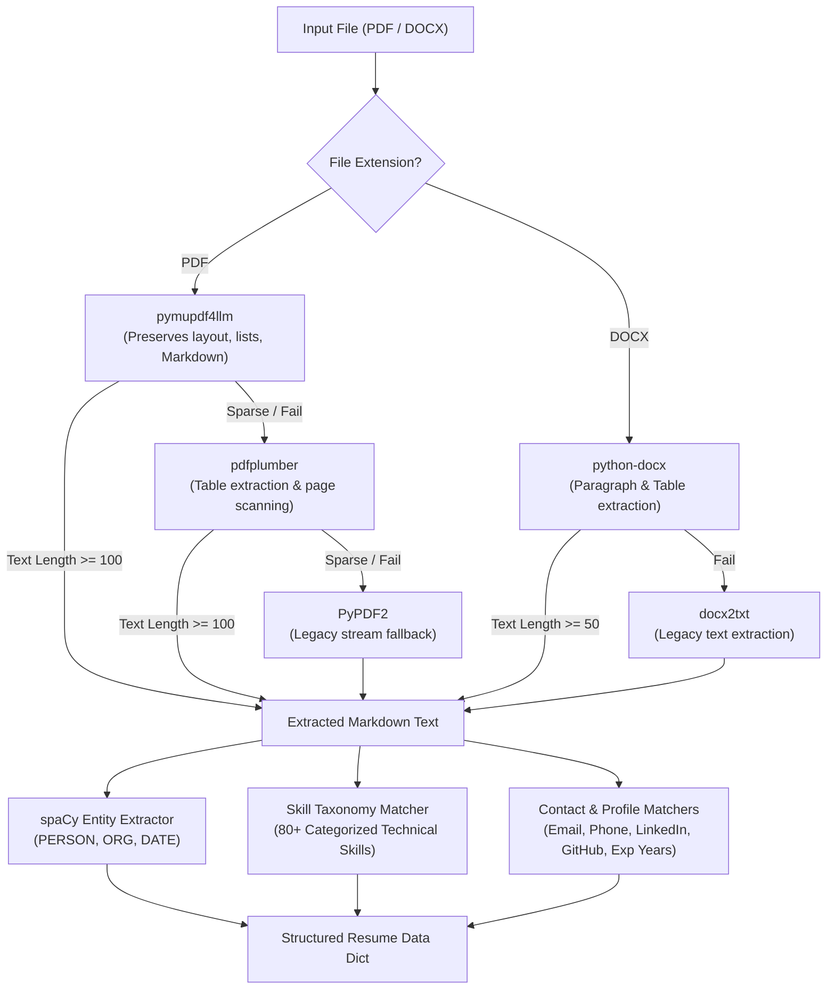
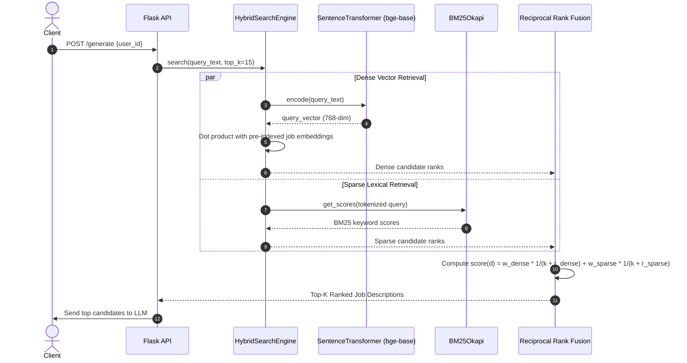
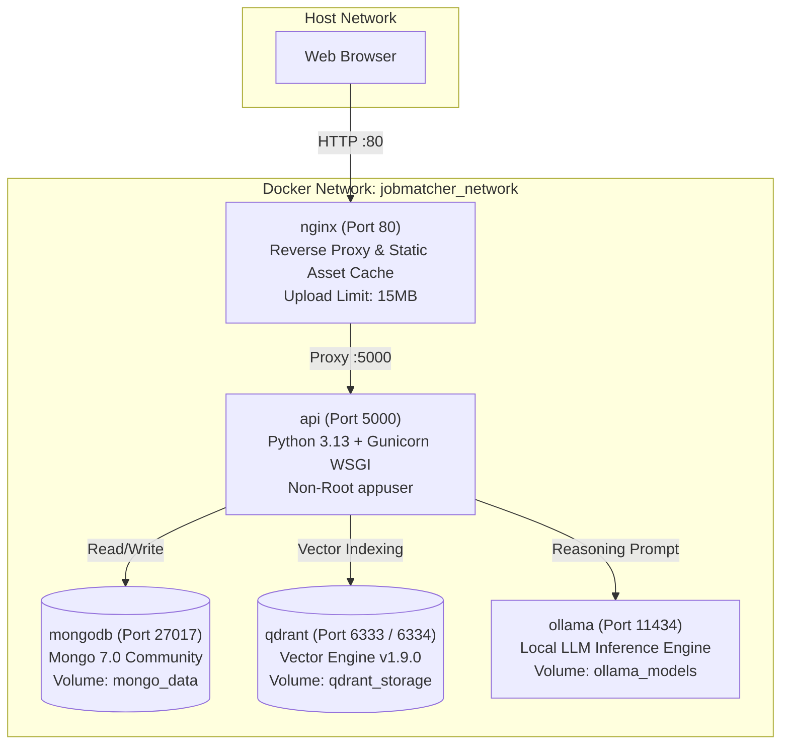

# 🏛️ Architecture Specification — AI Job Matcher v2.0

## 1. Overview & Architectural Goals

The AI Job Matcher system v2.0 was re-engineered from a prototype single-file script into an enterprise-ready, modular, and containerized platform. 

The architecture is designed around four core pillars:
1. **Extraction Fidelity**: Resumes come in non-standard formats (multi-column tables, scanned text, varied font hierarchies). The extraction layer must preserve structure.
2. **Hybrid Retrieval**: Pure dense vector search frequently fails on exact technical requirements (e.g. searching for "Go" might semantically match general programming but miss candidates with literal Go experience). Sparse lexical search solves this.
3. **Robust Separation of Concerns**: Isolating ingestion, database interactions, vector scoring, and prompt orchestration.
4. **Cloud & Container Portability**: Ready to run out-of-the-box locally via scripts or at scale across container clusters.

---

## 2. Ingestion & Document Parsing Pipeline

### Key Improvements over v1.0
- **Markdown Preservation**: `pymupdf4llm` transforms PDF layout into clean Markdown with headers (`#`, `##`) and bullet points (`*`). This drastically enhances embedding quality.
- **Full Text Retention**: Removed the `[:1000]` character cut-off that truncated critical work experience in the previous version.
- **Taxonomy Depth**: Expanded from 18 keywords to 80+ categorized terms spanning languages, frameworks, cloud platforms, and DevOps tools.

---

## 3. Hybrid RAG (Dense + BM25 + Reciprocal Rank Fusion)

The hybrid retrieval pipeline merges two distinct search paradigms:

### Reciprocal Rank Fusion Formula
$$RRF(d) = w_{\text{dense}} \cdot \frac{1}{k + r_{\text{dense}}(d)} + w_{\text{sparse}} \cdot \frac{1}{k + r_{\text{sparse}}(d)}$$

Where:
- $k = 60$ (smoothing constant preventing outlier rank dominance)
- $r_{\text{dense}}(d)$ is the 0-based rank of document $d$ in dense similarity
- $r_{\text{sparse}}(d)$ is the 0-based rank of document $d$ in BM25 scoring
- $w_{\text{dense}} = 0.6$ and $w_{\text{sparse}} = 0.4$ (configurable via `.env`)

---

## 4. Container & Infrastructure Topology

---

## 5. Security & Production Considerations

1. **Least-Privilege Execution**: The Docker container creates a dedicated `appuser` without root privileges.
2. **Upload Protections**: Uploaded files are assigned a cryptographically random UUID, checked for valid extensions, validated against minimum content criteria, processed, and immediately removed from local disk storage.
3. **Payload Buffering**: Nginx enforces a strict 15MB `client_max_body_size` preventing denial-of-service via huge file streams.
4. **Graceful Degradation**: If MongoDB or Ollama is temporarily unreachable during startup, the application logs structured warnings and maintains readiness rather than ungracefully crashing the Python process.
