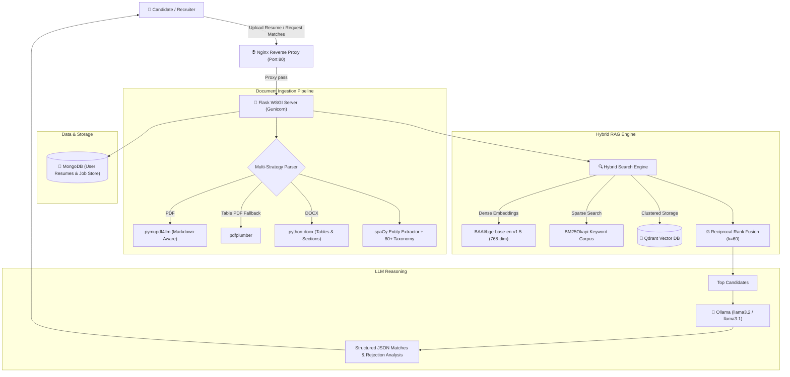

# 🎯 AI Job Matcher (Production v2.0)

[](https://www.python.org/downloads/)
[](https://www.docker.com/)
[](LICENSE)

An intelligent, production-grade headless REST API for resume parsing and job matching powered by **Multi-Strategy Document Parsing**, **Hybrid RAG (Dense + BM25 + Reciprocal Rank Fusion)**, and **Local LLM Analysis (Ollama)**.

---

## ⚡ What's New in v2.0 Architecture?

1. **📄 Upgraded Document Parsing**:
   - Replaced fragile `PyPDF2` with `pymupdf4llm` to preserve layout, tables, bullet points, and headers in clean Markdown.
   - Secondary fallback via `pdfplumber` for table-dense resumes and structured document handling.
   - Comprehensive DOCX parsing via `python-docx` extracting paragraph hierarchy and embedded tables.
   - Removed artificial character limits (`raw_text` is stored completely, maximizing RAG accuracy).
2. **🔍 Production Hybrid RAG**:
   - Upgraded from 384-dim `all-MiniLM-L6-v2` to **768-dim `BAAI/bge-base-en-v1.5`** state-of-the-art embedding model.
   - **Hybrid Retrieval**: Combines semantic dense embeddings with sparse lexical **BM25Okapi** keyword matching.
   - **Reciprocal Rank Fusion (RRF)**: Fuses dense semantic scores and exact keyword scores to guarantee accurate retrieval without score-calibration mismatches.
   - **Qdrant Vector Database**: Integrated connector supporting standalone in-memory mode or remote enterprise clustering (`QDRANT_URL`).
3. **🏷️ Expanded NLP & NER Extraction**:
   - Upgraded spaCy NER pipeline with an expanded taxonomy covering **80+ categorized technical skills**, cloud platforms, and frameworks.
   - Automated detection of LinkedIn profiles, GitHub handles, contact info, and years of experience.
4. **🏗️ Clean Modular Structure**:
   - Transitioned from a monolithic 567-line script into isolated, single-responsibility modules under `src/` (parsers, RAG, LLM, API blueprints, database, and utilities).
5. **🐳 Enterprise Docker & Containerization**:
   - Multi-container `docker-compose.yml` orchestrating API (Gunicorn WSGI), MongoDB 7.0, Qdrant Vector Store, Ollama LLM, and Nginx reverse proxy.
   - Non-root security user, built-in container healthchecks, and 15MB file upload handling.

---

## 🏛️ System Architecture



---

## 🚀 Quick Start

### Option A: Running with Docker Compose (Recommended)

Make sure [Docker Desktop](https://www.docker.com/products/docker-desktop/) is installed and running.

1. **Clone the repository**:
   ```bash
   git clone <repo_url>
   cd job_matcher
   ```

2. **Configure environment**:
   ```bash
   cp .env.example .env
   ```

3. **Start the complete stack**:
   ```bash
   docker compose up -d --build
   ```

4. **Access the application**:
   - API Service Catalog: [http://localhost](http://localhost)
   - API Healthcheck: [http://localhost/health](http://localhost/health)
   - Qdrant Dashboard: [http://localhost:6333/dashboard](http://localhost:6333/dashboard)

---

### Option B: Running Locally on Windows

1. **Prerequisites**:
   - Python 3.10+ (Recommended: Python 3.13)
   - [MongoDB](https://www.mongodb.com/try/download/community) running on port `27017`
   - [Ollama](https://ollama.com/) running with model `ollama run llama3.2:3b`

2. **Run the Automated Launcher**:
   ```cmd
   start.bat
   ```
   *The launcher will verify virtual environment dependencies, ensure MongoDB and Ollama services are up, and start the headless API gateway.*

3. **Manual Setup (Alternative)**:
   ```bash
   python -m venv venv
   .\venv\Scripts\activate
   pip install -r requirements.txt
   python -m spacy download en_core_web_sm
   python app.py
   ```

---

## 📂 Project Structure

```text
job_matcher/
├── config.py                 # Centralized environment configuration
├── app.py                    # Application factory and entry point (Pure JSON API)
├── Dockerfile                # Production non-root multi-stage Dockerfile
├── docker-compose.yml        # Orchestration (API, MongoDB, Qdrant, Ollama, Nginx)
├── requirements.txt          # Python dependencies with flexible version bounds
├── start.bat                 # Automated Windows startup script
├── nginx/
│   └── nginx.conf            # Nginx reverse proxy configuration (15MB upload limit)
├── src/
│   ├── api/
│   │   ├── __init__.py       # Blueprint registry
│   │   └── routes/
│   │       ├── upload.py     # POST /upload resume route
│   │       ├── generate.py   # POST /generate job matches route
│   │       └── health.py     # GET /health system status
│   ├── parsers/
│   │   ├── pdf_parser.py     # Multi-strategy PDF extraction (pymupdf4llm, pdfplumber)
│   │   ├── docx_parser.py    # DOCX layout & table extraction
│   │   └── resume_extractor.py # Regex + spaCy entity & skill extractor (80+ terms)
│   ├── rag/
│   │   ├── hybrid_search.py  # BM25Okapi + Dense cosine similarity with RRF
│   │   ├── qdrant_store.py   # Qdrant vector database connector
│   │   └── simple_rag.py     # High-level RAG orchestration & auto-indexing
│   ├── db/
│   │   └── mongo.py          # MongoDB client with fault-tolerant connection
│   ├── llm/
│   │   └── ollama_client.py  # Ollama API client & JSON extraction
│   └── utils/
│       ├── serializers.py    # MongoDB ObjectId & datetime serializers
│       └── validators.py     # Resume criteria & completeness validation
```

---

## 📡 REST API Reference

### 1. `GET /`
Service discovery endpoint returning API status, version, and route specifications.

- **Request**: `GET /`
- **Response**:
  ```json
  {
    "service": "AI Job Matcher API",
    "version": "2.0.0",
    "status": "online",
    "mode": "headless-api",
    "endpoints": {
      "catalog": "GET /",
      "health": "GET /health",
      "upload_resume": "POST /upload (multipart/form-data: 'file')",
      "generate_matches": "POST /generate (application/json: '{\"user_id\": \"...\"}')"
    }
  }
  ```

---

### 2. `POST /upload`
Upload a candidate resume in PDF or DOCX format.

- **Request**: Multipart Form Data (`file: <binary>`)
- **Response**:
  ```json
  {
    "message": "Resume processed successfully",
    "user_id": "a1b2c3d4",
    "parser_method": "pymupdf4llm",
    "pages": 1,
    "extracted_data": {
      "name": "Alex Doe",
      "email": "alex.doe@example.com",
      "phone": "+1234567890",
      "skills": ["Docker", "Flask", "Go", "Kubernetes", "Python"],
      "linkedin": "linkedin.com/in/alexdoe",
      "github": "github.com/alexdoe"
    }
  }
  ```

---

### 2. `POST /generate`
Generate AI-ranked job matches with skill gap analysis.

- **Request**:
  ```json
  {
    "user_id": "a1b2c3d4"
  }
  ```
- **Response**:
  ```json
  {
    "matches": [
      {
        "company_name": "CloudScale AI",
        "job_title": "Senior Backend Engineer",
        "match_score": 88,
        "match_reason": "Candidate has strong hands-on experience with Python, Docker, and distributed systems."
      }
    ],
    "rejection_analysis": {
      "potential_rejections": [
        {
          "company": "DataCorp",
          "reason": "Missing required 3+ years of Apache Kafka and Spark experience.",
          "skill_gaps": ["Kafka", "Spark"]
        }
      ],
      "skill_development": {
        "critical_missing_skills": ["Kubernetes Operators", "Event Streaming"],
        "improvement_suggestions": ["Build a real-time event pipeline project."],
        "recommended_certifications": ["CKA", "AWS Certified Developer"]
      }
    }
  }
  ```

---

### 3. `GET /health`
Returns live readiness status of all infrastructure components.

```json
{
  "status": "healthy",
  "version": "2.0.0",
  "services": {
    "mongodb": { "status": "ok", "job_count": 120 },
    "ollama": { "status": "ok", "configured_model": "llama3.2:3b" }
  }
}
```

---

## 🔒 Configuration (`.env`)

| Variable | Default | Description |
|---|---|---|
| `PORT` | `5000` | Port for the backend API |
| `MONGODB_URI` | `mongodb://localhost:27017/` | MongoDB connection URI |
| `OLLAMA_URL` | `http://localhost:11434` | Ollama service endpoint |
| `OLLAMA_MODEL` | `llama3.2:3b` | Target LLM model for match reasoning |
| `EMBEDDING_MODEL` | `BAAI/bge-base-en-v1.5` | 768-dim embedding model for RAG |
| `HYBRID_SEARCH_ENABLED` | `1` | Enable/Disable Dense + BM25 Hybrid Search |
| `DENSE_SEARCH_WEIGHT` | `0.6` | Ratio of dense vector weight in RRF fusion (0.0 to 1.0) |
| `RRF_K` | `60` | Reciprocal Rank Fusion smoothing parameter |
| `QDRANT_URL` | `None` | Optional remote Qdrant vector database URL |

---

## 📄 License
Distributed under the MIT License. See `LICENSE` for details.
